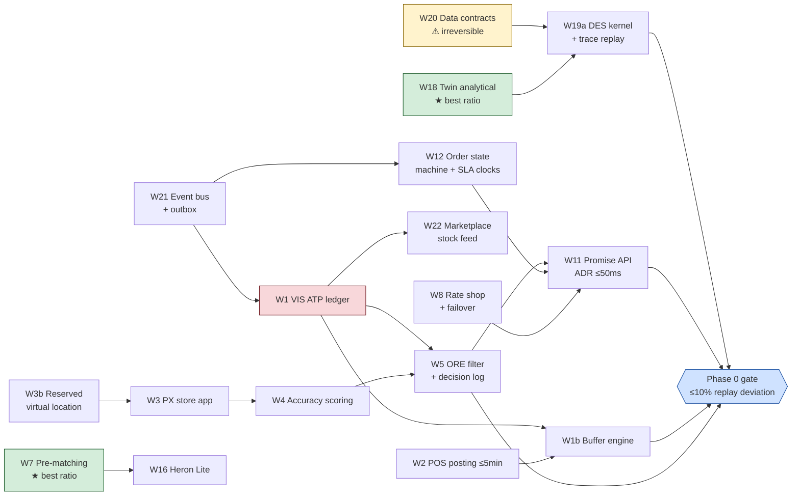

# ParaExpress — Roadmap & Technical Strategy

**Effort–impact analysis for execution planning**
Derived from `paraexpress.tex` (ParaTech Platform R&D Technical Report, Vol. 1 No. 1, Aug 2026).
Status: planning draft — effort figures are estimates, see [§3](#3-how-effort-and-impact-are-scored).

---

## 1. How to use this document

The paper answers *what to build and why it is correct*. This document answers *what to build first, what to skip, and what it costs*.

Every workstream below traces to a numbered result in the paper. That traceability is the point: it means prioritisation arguments can be settled by arithmetic rather than by opinion. Where a recommendation contradicts the paper's own phasing, it is flagged explicitly with the reason.

Three things this document asserts that the paper does not:

1. **The cheapest engineering item in the program is also the highest-leverage one** — courier pre-matching (§4, W7). It is ~6 engineer-weeks and it removes fulfillment nodes quadratically.
2. **The digital twin should be split in two.** The analytical layer (closed forms from Theorems 3/4 and Eq. 12) delivers most of the Phase 0–1 decision value for ~6 engineer-weeks. The discrete-event kernel is ~5× that and is not needed until Phase 2 — except for the minimum needed to pass the Phase 0 certification gate.
3. **One low-urgency item must be done first anyway** — the calibration data contracts (W20). It is the only workstream whose deferral is *irreversible*: history you did not capture cannot be back-filled, and without it the twin has nothing to calibrate against.

---

## 2. Strategic thesis

Five bets, each with the result that justifies it and the consequence if the bet is wrong.

| # | Bet | Grounded in | If wrong |
|---|-----|-------------|----------|
| **B1** | **Coverage is bought with contracts, not capex.** Activate Exagon consignment doors as fulfillment nodes before leasing anything. | Cor. 1 — `g` monotone, `c_fix ≈ 0` for store nodes ⇒ any door with positive marginal coverage improves profit | Coverage cost reverts to Astro/SPX economics; the asset-light differentiator disappears |
| **B2** | **In-node minutes are the real currency.** Engineering effort goes to compressing `t_node`, not to building more nodes. | Prop. 2 — `R = v(τ − T_route − t_node)`, `n_min ∝ A/R²` ⇒ quadratic return on every minute saved | Node count is set by the SLA rather than by economics; fixed cost scales linearly with ambition |
| **B3** | **Correctness before cleverness.** The ATP ledger is the keystone; the router is a solved problem. | Prop. 4 (oversell is a bounded, tunable risk *only if* the ledger is linearizable) vs. Thm. 5 (routing is exactly solvable — no research risk) | An oversell incident on a marketplace instant program is an account-level penalty, not a bug ticket |
| **B4** | **The promise is a computed product surface.** ADR quote, honest and pre-checkout, is the conversion lever — not the delivery itself. | Lesson L8; Table XI row 1 (benchmarks use static zone tables) | We match competitor speed but not competitor conversion; the investment does not monetise |
| **B5** | **Density before geography.** Saturate one South Jakarta cluster to SLA-profitability before any second metro. | Lesson L5 (Coupang positive, Getir inverse); Thm. 3 (`n*` scales with `Λ`, so thin demand over wide area is structurally the wrong shape) | The Getir failure mode: promotional growth, sub-scale order density, negative contribution at scale |

### 2.1 The one-slide version of B2

Prop. 2 with the paper's own design targets (`v = 20 km/h`, `τ = 60 min`, `T_route ≈ 0` since the ORE wave is ≤ 30 s):

| In-node time `t_node` | Feasible radius `R` | SLA-driven node floor `n_min` (indexed) |
|---|---|---|
| 15 min | 15.0 km | 1.00 |
| 12 min | 16.0 km | 0.88 |
| 10 min *(paper's target)* | 16.7 km | 0.81 |
| 8 min | 17.3 km | 0.75 |

Cutting in-node time from 15 to 8 minutes removes **~25% of the SLA-mandated node count**. Courier pre-matching alone — firing the Grab booking at pick start instead of pack end — recovers the `T_handover ≤ 3 min` budget by overlapping it with `T_pick`, i.e. roughly the 15→12 row: **~12% fewer nodes for ~6 engineer-weeks of ShipGo+ work.** At the paper's own Table IV rent of IDR 35–60M/month per dark MFC, that is a recurring saving larger than the one-off build cost within the first quarter of operation.

This is the single clearest effort/impact argument in the program, and it is why W7 is ranked first.

### 2.2 The corresponding anti-bet

**Do not over-invest in the Order Routing Engine's solver.** Thm. 5 proves the problem is a totally-unimodular transportation problem solvable in milliseconds; Remark 3 shows a 5–30 s micro-batch consumes a negligible share of the 60-minute budget. At pilot scale (`|F| ≈ 18–28` nodes, capacity rarely binding) a nearest-feasible greedy assignment is within a few percent of the exact optimum. The exact successive-shortest-path solver is a Phase 2 upgrade.

What *must* exist from day one is not the solver but the **decision log** — every routing decision append-only and replayable, because the paper's defining architectural property is that *the twin and the network share one decision codebase*. Retrofitting that contract later is expensive; the solver behind it is swappable.

---

## 3. How effort and impact are scored

### Effort
Engineer-weeks (**eng-wk**), planning-grade ±40%. Assumptions:

- Brownfield integration with existing MagPie, Heron, Exagon, ShipGo — includes integration and regression cost, not just new code.
- Excludes commercial/legal/site-acquisition effort, which is tracked separately in [§7](#7-non-engineering-workstreams) because it is calendar-bound rather than headcount-bound.
- Includes test and observability work to the NFR levels in the paper's Table X. **The NFRs are a large share of the cost** — VIS at 99.99% / 10 ms p99 / RPO 0 is expensive precisely because of those three numbers, not because the ledger logic is hard.

### Impact (1–5)
Scored on what the item unlocks, not on how visible it is:

| Score | Meaning |
|---|---|
| **5** | Gate item — a phase cannot exit without it, or its absence creates unbounded risk |
| **4** | Materially moves a KPI in the paper's Table XIII, or removes a named risk |
| **3** | Required at scale, deferrable at pilot volume |
| **2** | Efficiency gain, no capability change |
| **1** | Optionality only |

### Priority
`Impact ÷ Effort`, then **overridden** by two rules that ratio alone cannot express:

- **Irreversibility override** — items whose deferral destroys future options are promoted regardless of ratio (W20, W25, W5's decision log).
- **Critical-path override** — items on the serial dependency chain are promoted regardless of ratio (W21, W1).

---

## 4. Workstream inventory

### 4.1 New platform services

| ID | Workstream | Traces to | Effort | Impact | Ratio | Phase |
|---|---|---|---|---|---|---|
| **W1** | VIS ATP ledger core — linearizable reserve/release, atomic compare-and-decrement, event-sourced audit | Prop. 4 | 24 | 5 | 0.21 | 0 |
| **W1b** | VIS buffer engine — auto-tune `s_fk` from per-store posting-latency history | Prop. 4 | 6 | 4 | 0.67 | 0 |
| **W1c** | DOM cross-node policies — split rules, node-down rebalancing, substitution | §VIII-E | 10 | 3 | 0.30 | 1 |
| **W5** | ORE feasibility filter + cost model + **decision log** | Thm. 5, Rem. 3 | 10 | 5 | 0.50 | 0 |
| **W6** | ORE exact SSP min-cost-flow solver + adaptive wave scheduler | Thm. 5 | 8 | 3→5 | 0.38 | **2** |
| **W18** | **ParaTwin v0 — analytical layer.** Thm. 3 cubic solver, Prop. 2 radius/floor, Eq. 12 staffing, Thm. 4 matroid/knapsack assortment, Cor. 1 marginal-coverage store ranking | Thms. 2–4, Prop. 3 | **6** | **5** | **0.83** | 0 |
| **W19a** | ParaTwin DES kernel (single metro) + trace-driven replay — *minimum to pass the Phase 0 gate* | Def. 4, §IX-C | 14 | 5 | 0.36 | 0 |
| **W19b** | ParaTwin experiment manager, scenario DSL, portfolio E1–E6, ranking & selection, monthly re-certification | §IX-D/E | 16 | 4 | 0.25 | **2** |

### 4.2 Existing systems, extended

| ID | Workstream | Traces to | Effort | Impact | Ratio | Phase |
|---|---|---|---|---|---|---|
| **W11** | MagPie+ Promise API (ADR), ≤50 ms p99 | L8, Table VI | 12 | 5 | 0.42 | 0 |
| **W12** | MagPie+ order state machine, SLA clocks per state, PX1→PX2→PX3 waterfall | §V-C, Table VI | 10 | 5 | 0.50 | 0 |
| **W13a** | MagPie+ brand.com + WhatsApp adapters | Table VI | 6 | 4 | 0.67 | 0 |
| **W13b** | MagPie+ marketplace adapters (Shopee, TikTok/Tokopedia instant programs) | Table VI | 10 | 5 | 0.50 | 1 |
| **W14** | MagPie+ bundle explosion with single-node co-location constraint | Table VI | 6 | 4 | 0.67 | 0 |
| **W15** | MagPie+ SLA cockpit — α-attainment per class/zone/node, breach root-cause tags | Table VI | 6 | 5 | 0.83 | 0 |
| **W22** | Per-node buffered stock-feed publication to marketplaces | §VIII-E | 8 | 5 | 0.63 | 1 |
| **W2** | **Exagon+ POS sale posting within ℓ ≤ 5 min** | Prop. 4 premise | 8 | 5 | 0.63 | 0 |
| **W3** | Exagon+ PX store app (Android): accept/pick/pack/handover, per-step timers, photo QC | §VIII-C | 14 | 5 | 0.36 | 0 |
| **W3b** | Exagon+ reserved virtual location — ParaExpress stock as a distinct ledger location, locked shelf unit | §VIII-C | 6 | 5 | 0.83 | 0 |
| **W4** | Exagon+ accuracy scoring → ORE eligibility gate | §VIII-C(iv) | 4 | 4 | 1.00 | 0 |
| **W7** | **ShipGo+ courier pre-matching at pick start** | Prop. 2 | **6** | **5** | **0.83** | 0 |
| **W8** | ShipGo+ Grab/GoSend rate shop, dual-carrier failover, surge-aware `c_of` refresh | Thm. 5 coefficients | 10 | 4 | 0.40 | 0 |
| **W9** | ShipGo+ mid-mile wave tendering to MOSTRANS, e-POD, SLA penalty tracking | §VIII-D(iii) | 10 | 3→5 | 0.30 | **1→3** |
| **W10** | ShipGo+ batched PX2 multi-stop VRP (savings + 2-opt, ≤8 stops) | Rem. 3, §VIII-D(ii) | 12 | 2→4 | 0.17 | **2** |
| **W16** | Heron Lite tablet WMS — dynamic pick path, QR scan-verified picks, pack QC, offline store-and-forward | §VIII-B | 20 | 5 | 0.25 | 1 |
| **W17** | Heron Lite ABC cycle counting + labor planning via Eq. 12 shift templates | §VIII-B | 8 | 3 | 0.38 | **2** |

### 4.3 Platform foundations

| ID | Workstream | Traces to | Effort | Impact | Ratio | Phase |
|---|---|---|---|---|---|---|
| **W20** | **Calibration data contracts + lakehouse landing** (Table XII feeds, freshness gates, schema registry) | §IX-C | 14 | 5 | 0.36 | **0 — irreversible** |
| **W21** | Integration layer: event bus, transactional outbox, idempotent at-least-once delivery, per-entity partitioning | §VIII-H | 12 | 5 | 0.42 | 0 |
| **W25** | Security baseline: mTLS + OAuth2 service auth, node-granular RBAC, address tokenisation with post-POD purge | §VIII-I | 8 | 4 | 0.50 | **0 — retrofit cost is 3–4×** |

### 4.4 Explicitly not building

| ID | Workstream | Why not | Reversal trigger |
|---|---|---|---|
| **W23** | Own motorcycle fleet | Paper §VII-B: utilisation needed to beat Grab's marginal per-km cost is unattainable outside the top-3 Jakarta clusters; fleet management is not a comparative advantage | Sustained **>35–45 orders/day per rider-equivalent at ≥70% working-hour utilisation** in a specific cluster — monitored per cluster by ParaTwin |
| **W24** | Anticipatory / campaign-aware pre-positioning | Phase 4 moat item; requires a certified twin and multi-metro demand history that will not exist before month 30 | Twin certified for ≥2 consecutive quarters **and** ≥3 metros live |
| **W26** | Full Heron rollout to MFCs | Heron is engineered for the Tegal parcel DC; forcing it into a 200 m² node imports cost with no benefit — Heron Lite exists for this reason | None — this is a permanent architectural decision |

---

## 5. Prioritisation

### 5.1 Quadrant

```
IMPACT
  ▲
  │  W7  pre-matching          │  W1   VIS ATP ledger
5 │  W18 twin analytical layer │  W21  event bus
  │  W4  accuracy scoring      │  W11  promise API
  │  W15 SLA cockpit           │  W3   PX store app
  │  W3b reserved location     │  W13b marketplace adapters
  │  W2  POS posting ≤5 min    │  W19a DES kernel + replay
  │  W14 bundle co-location    │  W16  Heron Lite
  │  W20 data contracts ⚠      │  W25  security baseline
  │ ─────────────────────────── │ ───────────────────────────
  │  W1b buffer engine         │  W6   exact SSP solver
3 │  W13a direct adapters      │  W19b experiment manager
  │  W22 stock feed            │  W9   mid-mile automation
  │                            │  W10  batched PX2 VRP
  │                            │  W17  labor planning
  └────────────────────────────┴───────────────────────────▶
      LOW EFFORT                    HIGH EFFORT          EFFORT

  ⚠ = irreversibility override applies: schedule now, payoff later
```

### 5.2 Sequenced call

**Start in week 1 (parallel, no dependencies):**
`W20` data contracts · `W7` pre-matching · `W18` twin analytical layer · `W2` POS posting · `W25` security baseline · `W21` event bus

Rationale: W7 and W18 are the two highest ratios in the program and neither blocks on anything. W20 and W25 have mediocre ratios but both are irreversible-if-skipped. W21 is the critical-path root.

**Start when W21 lands:** `W1` → `W1b`, `W5`, `W12`
**Start when W1 exposes a stable reserve API:** `W11`, `W22`, `W13a`
**Store-node track (independent of the VIS critical path until integration):** `W3b` → `W3` → `W4`

**Defer with an explicit trigger, not vaguely:**

| Deferred | Trigger to build |
|---|---|
| W6 exact solver | More than 30 nodes in a metro **or** observed greedy-vs-optimal regret > 3% in twin shadow replay |
| W10 batched PX2 VRP | PX2 volume > 15% of instant orders **or** PX2 rider cost/order > 1.3× PX1 |
| W16 Heron Lite | First dark MFC lease signed (it is not needed while the pilot is store-node-only) |
| W17 labor planning | Any node exceeding 6 pickers/shift — below that, manual rostering is cheaper than the software |
| W19b experiment manager | Entry into Phase 2 scale-out planning |
| W9 mid-mile automation | Second metro, or >6 nodes per hub (below that, Parama scheduled milk runs plus a spreadsheet is adequate) |

---

## 6. Phased roadmap

Phases and gates follow the paper's §X. Effort totals and the staffing implication are added here.

### Phase 0 — Foundations (months 0–4)

> **Detailed execution plan, including the non-engineering tracks (people/org, legal, commercial, process, data, finance, property): [PHASE0.md](PHASE0.md)**

**Build:** W20, W21, W25, W1, W1b, W5, W7, W8, W11, W12, W13a, W14, W15, W2, W3, W3b, W4, W18, W19a
**Engineering effort: ≈ 182 eng-wk**

**Exit gate (paper):** ParaTwin certification — trace-replay ≤ 10% per-KPI deviation against one historical week.
**Added gate:** VIS sustains 5k reservations/s at RPO 0 with an injected AZ failure, and zero oversells in a 72-hour POS-latency chaos test with `ℓ` forced to 15 min (validates that the W1b buffer engine actually implements Prop. 4 rather than assuming it).

> **⚠ Schedule risk — the highest in the program.** 182 eng-wk inside a 4-month window (~17 calendar weeks) requires a sustained **~11 FTE** engineering team at full parallelism. At 6 FTE, Phase 0 is a **7-month** phase. The serial critical path — `W21 → W1 → W5 → W12 → W11` — is roughly 14 weeks even with unlimited staff, so 4 months leaves almost no slack for integration discovery. **Recommendation: either commit 10+ FTE, or re-baseline Phase 0 to 6 months and say so up front.** Compressing by cutting scope is not available here — every Phase 0 item is a gate item or an irreversibility item.

### Phase 1 — Pilot (months 4–9)

**Target (paper):** 15–25 consignment store nodes + 2 dark MFCs + 1 flagship MFC in one South Jakarta cluster; brand.com plus one marketplace instant program live.
**Build:** W13b, W22, W16, W1c, W9 (manual-assisted)
**Engineering effort: ≈ 58 eng-wk**, plus sustained pilot-ops support

**Exit gate (paper):** PX1 α ≥ 0.93 observed · contribution/order within 15% of twin prediction · store-node pick SLA ≥ 90%.
**Added gate:** store-node accuracy scores stable — no more than 10% of activated doors demoted by W4 scoring. If store accuracy cannot hold, bet **B1** is falsified and the whole asset-light thesis needs re-planning before Phase 2 capital is committed. This is the pilot's real question; the SLA numbers are secondary because they can be bought with more nodes, while B1 cannot be bought at all.

### Phase 2 — Jakarta scale-out (months 9–18)

**Build:** W6, W10, W17, W19b
**Engineering effort: ≈ 44 eng-wk**
**Gate (paper):** network contribution positive · promise-shown rate ≥ 80% of metro zone-hours.

This is where the deferred items come due, and where the twin stops being a certification formality and starts being the planning instrument (E1 node sweep, E2 assortment ladder, E4 campaign burst).

### Phase 3 — Multi-metro (months 18–30)

Bandung, Surabaya, Medan, Makassar via regional hubs. **W9 mid-mile automation becomes a gate item here** (impact 3→5): manual wave tendering does not survive more than one hub. Own-fleet threshold reviewed per cluster against the W23 trigger.

### Phase 4 — Moat (months 30+)

W24 anticipatory placement; ParaExpress-as-a-service for adjacent halal FMCG brands. Neither is a technology problem at this point — both are gated on twin certification maturity and on commercial appetite.

### 6.1 Dependency graph



---

## 7. Non-engineering workstreams

These are calendar-bound, not headcount-bound. Several have lead times longer than the engineering they gate — **start them before Phase 0 engineering, not alongside it.**

| Workstream | Owner | Lead time | Impact | Note |
|---|---|---|---|---|
| Marketplace instant-program enrolment (Shopee, TikTok/Tokopedia) | Commercial | **3–6 months** | 5 | Longest lead time in the program and entirely outside our control. Start in week 1 of Phase 0. Phase 1's gate depends on it. |
| Consignment agreement addendum — reserved stock, pick SLA, per-order fee, cycle-count duty | Legal + Commercial | 2–3 months | 5 | Gates every store node. Template once, then replicate — do not negotiate door by door. |
| Store-node partner recruitment & training (15–25 doors) | Field ops | 2 months | 5 | Recruit against W18's marginal-coverage ranking (Cor. 1), **not** by store size or standalone sales — the paper is explicit that the intuitive ordering is the wrong one. |
| Grab / GoSend commercial terms (volume-tiered per-km) | Commercial | 2 months | 4 | Dual-carrier from day one; single-carrier terms create surge exposure the router cannot price around. |
| MOSTRANS mid-mile contract (per-route tariff + SLA penalties) | Commercial | 2 months | 3 | Deferrable to late Phase 1 — Parama covers a single pilot cluster. |
| Site selection + lease, 2 dark MFC + 1 flagship | Property | 3–4 months | 4 | Filters from §VI-A: P1-solution demand-cell centroid · motorcycle arterial access in all catchment directions (isochrone, not Euclidean) · rent ≤30–40% of equivalent retail frontage. |

---

## 8. Risk register

| Risk | Paper's mitigation | Added engineering cost | Residual |
|---|---|---|---|
| **Store data quality** — the classic ship-from-store killer | Prop. 4 buffers, accuracy-gated eligibility, locked shelf units | W1b + W2 + W4 ≈ 18 eng-wk | Medium. Bounded by a computable Poisson tail *only if* `ℓ` is genuinely observed rather than assumed. Instrument `ℓ` per store from day one. |
| **Phase 0 staffing shortfall** | *(not addressed in the paper)* | — | **High — the top program risk.** See §6 Phase 0. Mitigate by re-baselining the calendar, not by cutting gate items. |
| **Marketplace program dependence** | Multi-channel demand; direct channels growing under the same promise | W13a first (brand.com is fully under our control) | Medium. Sequencing brand.com ahead of marketplaces buys a fallback demand source before the partner dependency binds. |
| **Courier surge / supply** | Dual carrier, pre-matching, own-fleet trigger rule | W8 ≈ 10 eng-wk | Low-medium. Dual-carrier failover ≤30 s per Table X. |
| **Twin drift** | >48 h master-data staleness refusal; monthly re-certification | W20 freshness gates | Low, *provided* W20 is not deferred. This is the failure mode that makes twin output quietly wrong rather than loudly broken. |
| **B2B door cannibalisation** | Store-node program shares order economics with the doors that would otherwise lose the sale | — | Commercial, not technical. Model it in the W18 marginal-coverage ranking so the settlement maths is visible to partners before signing. |
| **Demand overestimation** | Twin-calibrated phase gates; every node opening reversible (short leases, contractual addenda) | — | Low by design — reversibility is the mitigation. Protect it: resist long leases offered at a discount. |

---

## 9. Instrumentation — how we know it is working

From Table XIII, the subset that should be live before the pilot opens rather than after:

| Signal | Source | Why this one, early |
|---|---|---|
| **Promise-shown rate** (% of zone-hours with PX1 offered) | W15 cockpit | The leading indicator. Falls before α-attainment does, and diagnoses coverage gaps while they are still cheap to fix. |
| **α-attainment by class / zone / node** with breach root-cause tags | W15 cockpit | The Phase 1 gate metric. The *tags* matter more than the rate — queue vs. pick vs. courier vs. traffic each point at a different workstream. |
| **`t_node` distribution p50/p95 per node format** | W3 / W16 timers | Directly drives `R` and therefore node count (§2.1). Measure it before optimising it. |
| **POS posting latency `ℓ` per store** | W2 | The input to Prop. 4's buffer. Unmeasured `ℓ` means the oversell bound is decorative. |
| **Contribution/order vs. twin prediction** | W18 + W15 | The Phase 1 gate. Divergence here invalidates the twin, not the network. |
| **Store accuracy score distribution** | W4 | The real test of bet B1. |
| **Greedy-vs-optimal routing regret** | W5 decision log replay | The trigger metric for W6. Cannot be measured without the decision log — another reason it ships in Phase 0. |

---

## 10. Open questions requiring a business decision

These cannot be resolved from the paper and each changes the plan materially:

1. **Phase 0 headcount.** 10–11 FTE for 4 months, or 6 FTE for 7 months? This is the single largest fork in the roadmap. (§6)
2. **Which marketplace first?** Shopee has ~63% of platform beauty GMV, so it is the volume answer; TikTok/Tokopedia may have the more accessible instant-program integration. Enrolment lead time means this must be decided before engineering starts. (§7)
3. **Pilot cluster boundary.** The paper says "South Jakarta cluster" — the exact polygon determines `A`, hence `n_min` and `n*`, hence the entire Phase 1 build list. W18 can compute it once the boundary is fixed.
4. **Store-node fee structure.** Per-order pick fee sits directly in `c_var` of (P1) and therefore in the routing cost `c_of`. Set it too high and the optimiser will route around the store estate the program is built on.
5. **Oversell risk appetite.** Prop. 4 gives a tunable Poisson tail. The buffer `s_fk` trades oversell probability against forward-stock availability — a commercial decision that engineering should not make silently.

---

## Appendix — Effort summary

| Phase | Eng-wk | Cumulative | Non-eng gating |
|---|---|---|---|
| Phase 0 — Foundations | 182 | 182 | Marketplace enrolment, consignment addendum |
| Phase 1 — Pilot | 58 | 240 | Partner recruitment, site leases |
| Phase 2 — Jakarta scale-out | 44 | 284 | — |
| Phase 3 — Multi-metro | ~40 (est.) | ~324 | Regional hub readiness, MOSTRANS contract |
| Phase 4 — Moat | TBD | — | Twin certification maturity |

**Estimates are planning-grade (±40%)** and assume brownfield integration cost with the four existing systems, delivery to the Table X non-functional requirements, and no allowance for partner-side API surprises. Re-baseline after the first two workstreams complete, when the team's actual velocity against this codebase is known — the first two are chosen (W7, W18) partly because they are small enough to calibrate against quickly.

---

*Traceability: every workstream cites the theorem, proposition, or section of `paraexpress.tex` it implements. Where this document departs from the paper's phasing — splitting ParaTwin (W18/W19a/W19b), deferring the exact ORE solver (W6), and promoting the data contracts (W20) — the reasoning is stated inline in §2 and §5.*
